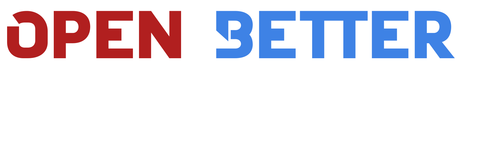

# Open BetterDiscord (macOS fork)

<div align="center">


</div>

[![CI Status][ci-badge]][ci-link] [![License][license-badge]][license-link] [![Discord][discord-badge]][discord-link] [![Reddit][reddit-badge]][reddit-link] [![Website][website-badge]][website-link] [![Docs][docs-badge]][docs-link] [![Translate][translate-badge]][translate-link]

[ci-badge]: https://img.shields.io/github/actions/workflow/status/XxUnkn0wnxX/OpenBetterDiscord/ci.yml?branch=develop&logo=github&label=Build&color=B11F1F&style=for-the-badge
[ci-link]: https://github.com/XxUnkn0wnxX/OpenBetterDiscord/actions/workflows/ci.yml
[license-badge]: https://img.shields.io/badge/license-Apache--2.0-3a71c1?style=for-the-badge
[license-link]: LICENSE.md
[website-badge]: https://img.shields.io/badge/upstream-website-3a71c1?logo=firefoxbrowser&style=for-the-badge
[website-link]: https://betterdiscord.app
[docs-badge]: https://img.shields.io/badge/upstream-docs-3a71c1?logo=readthedocs&style=for-the-badge
[docs-link]: https://docs.betterdiscord.app
[discord-badge]: https://img.shields.io/badge/Discord-7289da?logo=discord&logoColor=white&style=for-the-badge
[discord-link]: https://discord.gg/e66JbKte2P
[reddit-badge]: https://img.shields.io/badge/Reddit-join-FF4500?logo=reddit&logoColor=white&style=for-the-badge
[reddit-link]: https://www.reddit.com/r/OpenBetterDiscord/
[translate-badge]: https://img.shields.io/badge/upstream-translate-3a71c1?logo=crowdin&style=for-the-badge
[translate-link]: https://translate.betterdiscord.app

Open BetterDiscord is an independent backport of
[BetterDiscord](https://github.com/BetterDiscord/BetterDiscord), targeting older
Discord clients on **macOS Big Sur 11.7.1** and pinned Discord/Electron builds.
Build locally from `develop`, inject into a standard macOS Discord installation,
then open Discord normally. Open BetterDiscord supports freedom of expression
and user choice: people should be free to choose what they install on their own
Discord clients, without judgment or discouragement.

The Website, Docs and Translate badges link to upstream community resources.
The Discord badge links to a community I support. Open
BetterDiscord is not formally affiliated with it. This fork uses the local build
workflow below, not upstream installer downloads.

## :sparkles: How this fork differs

<details>
<summary>Intentional fork features</summary>

| Area | Fork behavior |
| --- | --- |
| macOS workflow | Local wrappers build, inject and remove Open BetterDiscord on Stable, PTB or Canary. Update recovery preserves the application payload and coordinates with OpenAsar. |
| [Addon updates](docs/addon-updater.md) | Selects eligible declared URLs and Store entries by addon identity and version; equal versions prefer the declared URL. |
| [Access tokens](docs/provider-tokens.md) | Optional GitHub, GitLab.com and git.slowb.ro authentication for eligible managed addon updates, with validated settings and masked diagnostics. |
| Update policy | Open BetterDiscord core checks remain dormant. Plugin and theme updates and the Addon Store remain available. |
| Plugin loading | Disabled plugins and libraries remain disabled; libraries receive no loading bypass. |
| Recovery reports | Drafts supported GitHub, GitLab.com and git.slowb.ro reports with Client Info; Manual report copies details when no supported source is available. |
| Keyboard focus | A scoped visible indicator improves keyboard-focus feedback in Open BetterDiscord controls without changing focus order. |
| Release provenance | The rolling `develop-latest` release includes the ASAR and eight-input checksums, with branch/commit build metadata. |

</details>

See the concise [fork overview](docs/fork-overview.md) for the feature map. The
[fork record](docs/fork-specific-changes.md) defines preservation and
replacement criteria for future upstream merges, including reinjection review
on a supported newer system.

## :apple: Supported workflow

This repository is maintained and documented for standard local Discord
installations on macOS. Upstream code may continue to support other operating
systems, but Windows and Linux installation are outside this fork's supported
workflow.

macOS Big Sur is an active compatibility target. Maintain compatibility with
**Electron 35.x–37.x** for pinned Discord Stable builds in the
`0.0.350`-`0.0.402` range. New upstream features must account for those older
client runtimes, even when the development dependency uses a different Electron
version. Use capability-based internal adaptations when a missing API is
demonstrated, preserving upstream plugin contracts.

Current pinned client targets, verified from installed application metadata on
2026-11-08:

| Discord branch | Discord version | Electron version |
| --- | --- | --- |
| Stable | `0.0.402` | `37.6.0` |
| PTB | `0.0.248` | `37.6.0` |
| Canary | `0.0.1205` | `37.6.0` |

Electron **37.6.0** has recorded native validation in the
[fork record](docs/fork-specific-changes.md); evidence remains specific to the
feature and client tested. Local builds and tests use **Bun 1.1.20**, the
temporary older-macOS tooling pin. Passing those checks does not establish a
native pass on every target, and Discord may stop serving or connecting to
historical client builds.

Prerequisites:

- macOS with Discord Stable, PTB, or Canary installed normally;
- [Bun](https://bun.sh/) **1.1.20**, the current temporary host-compatibility
  pin in `package.json`, available in `PATH`;
- Git and a standard command shell; the optional macOS wrappers require Zsh.

## :hammer_and_wrench: Build and inject

Clone the fork's `develop` branch and install its dependencies:

```sh
git clone --branch develop https://github.com/XxUnkn0wnxX/OpenBetterDiscord.git
cd OpenBetterDiscord
bun install
```

<details>
<summary>Direct Bun commands</summary>

Build and stage a packaged release ASAR, then inject it into Stable:

```sh
bun run release -mrts 45
bun run inject release stable
```

Close every Discord channel before `bun run release`; it stages over the shared
managed release ASAR. Normal Bun inject and uninject commands close only the
selected channel and leave it closed. Dry-run, check, and prepare-only
operations do not close a client. Replace `stable` with `ptb` or `canary` when
needed.

For local renderer development, inject the unpacked build:

```sh
bun run dev --module=betterdiscord
bun run inject stable
```

Channel-only injection defaults to development mode. In direct injection,
`bun run inject dist stable` also selects unpacked output. `bun run release`
builds, packages, and stages the production release; the legacy `bun run dist`
command remains equivalent. The legacy `bun run build` command remains the
unpacked-build equivalent of `bun run dev`.

Restore the original payload with:

```sh
bun run uninject stable auto
```

Uninject preserves a nested OpenAsar payload and leaves the selected channel
closed. It does not delete the shared managed ASAR or user data such as settings
and plugins.

These Bun commands do not require Zsh. Windows, Linux, and WSL paths are
available to try, but native validation and the maintained runtime target are
macOS. See the [Bun build and injection guide](docs/build-and-injection.md) for
host-specific paths and command details.

</details>

<details>
<summary>macOS wrappers</summary>

The Zsh wrappers are macOS-only. Build and inject a packaged release with:

```sh
./local-build.zsh release -mrts 45
./local-inject.zsh stable
```

With no mode, `local-build.zsh` also defaults to the packaged release, and
`local-inject.zsh` defaults to release mode. The build wrapper does not close
Discord; close all channels before it stages the shared release ASAR. The
inject wrapper closes only the selected channel and leaves it closed.

In wrapper commands, `./local-build.zsh dev` and `./local-build.zsh dist`
produce unpacked development output, and `./local-inject.zsh stable dev` and
`./local-inject.zsh stable dist` inject it. `local-build.zsh build` is the
older alias for the same development build. This wrapper meaning of `dist`
differs from the production package command `bun run release` (also available as
legacy `bun run dist`). For removal,
`./local-uninject.zsh stable` defaults to release mode, closes only Stable, and
leaves it closed; `auto` remains available. See the
[macOS wrapper and recovery guide](docs/manual-install.md) for mode details and
dry-run options.

</details>

## :book: Documentation

| Guide | Find |
| --- | --- |
| [Build and injection with Bun](docs/build-and-injection.md) | Portable commands, managed release path, dry runs, host path behavior and removal |
| [macOS wrappers and recovery](docs/manual-install.md) | Zsh wrappers, automatic client closing, recovery and OpenAsar |
| [Plugin and theme updates](docs/addon-updater.md) | Sources, selection rules, scheduling and troubleshooting |
| [Access tokens](docs/provider-tokens.md) | Token creation, permissions, validation and logs |
| [Plugin API notes](docs/plugin-api-notes.md) | Optional helpers, examples and runtime evidence |
| [Fork record](docs/fork-specific-changes.md) | Preserved behavior and upstream integration decisions |

[All documentation](docs/README.md) · [Contributing](CONTRIBUTING.md) ·
[Changelog](CHANGELOG.md) · [License](LICENSE.md)

## :link: Upstream and license

BetterDiscord is the upstream project. Open BetterDiscord preserves its
upstream authorship and remains available under the
[Apache License 2.0](LICENSE.md). Fork-specific support and changes should be
handled in this repository rather than through the upstream installer support
flow.
